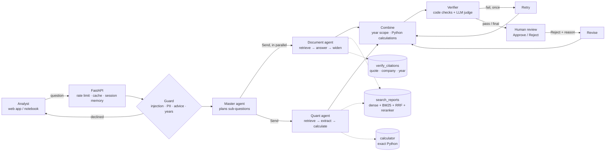

# InvestIQ Advisor

**Team SPARTVIT-AI · IIT Kharagpur × upGrad Executive PG Programme in Generative & Agentic AI · Capstone Track B (API-side)**

An evidence-only research assistant over Microsoft and Apple annual reports (Form 10-K, fiscal years 2025–2026). A LangGraph multi-agent system built entirely on a hosted **Qwen3-8B** chat endpoint and a **bge-small** embeddings endpoint: no fine-tuning, no frontier model. Every claim is cited to a file, page and verbatim quote; a verifier and an analyst (human-in-the-loop) check each answer; the system refuses investment advice, forecasts and personal data.

## Architecture



All nodes, tools and model calls emit **OpenTelemetry** spans.

## Track B requirements → where they are

| Requirement | Implementation | Where |
|---|---|---|
| Task spec, refusal policy, 60–100 query eval set written first | 60 questions with gold answers and gold pages verified against the PDFs, 8 must-refuse | `eval/`, notebook §10 |
| Prompt-engineering baseline, ≥3 strategies, how the small model breaks | zero-shot vs few-shot structured output vs chain-of-thought vs decomposition, with a breakage table (invalid JSON, failed citations, abstentions) | notebook §10b |
| RAG: chunking, hybrid BM25 + dense, reranker, citations, recall@k measured separately | ~120-word chunks; FAISS + own BM25 fused by RRF; cross-encoder `BAAI/bge-reranker-base`; recall@1/3/5/8 for 4 methods; quote-verified citations | notebook §6–7b |
| Agentic layer: planner → executor → critic, ≥3 tools, persistent state, error handling | LangGraph master → document/quant sub-graphs → verifier (critic) with retry; three LangChain tools: `search_reports` (hybrid + reranker), `calculator` (exact Python), `verify_citations` (code check of quotes, companies and years); `MemorySaver` checkpointer + session memory; retries/backoff, JSON validation with self-correction, loop caps, token caps | notebook §4, §11 |
| Evaluation & observability | accuracy, task completion, tool calls/task, cost & latency (p95), failure taxonomy (retrieval miss / reasoning / tool-call / hallucination), direct vs decomposition, RAGAS; OpenTelemetry tracing + trace dashboard | notebook §12, §13, §13c |
| Ship it: front end, containerised, rate limiting, caching | FastAPI + web app, Dockerfile + compose, per-client rate limit (429), cache of verified answers, `/stats` | `app/`, `Dockerfile`, notebook §15 |
| Responsible AI | 20-test red-team suite: direct and corpus prompt injection, PII requests and PII masking in logs, misuse, refusals, human-in-the-loop boundary | notebook §13b, `results/redteam_log.csv` |

## What we did to compensate for a small (8B) model

- **Code, not the model, does the checking:** every quote must appear in its passage; every figure in a summary must appear in a cited claim; years outside the loaded reports are dropped.
- **Code, not the model, does arithmetic:** the quant agent only *selects* figures; Python computes; order errors (part/whole, old/new) are fixed in code.
- **Schema validation + self-correction:** an invalid JSON reply is sent back once with the reason it was rejected.
- **Decomposition:** one sub-question per company and year keeps each prompt small enough for the model.
- **Hybrid retrieval + reranker:** keyword search catches exact 10-K terms the small embedding model misses.
- **Rule guards before the model:** advice, forecasts, injection and personal-data requests are refused without a model call.
- **Human-in-the-loop:** nothing is used until an analyst approves it; a rejection with a reason triggers one revision.

## Run it

**Colab (development and evaluation):** see [`docs/TEAM_SETUP.md`](docs/TEAM_SETUP.md). Open `notebooks/InvestIQ_Advisor_v3_22.ipynb`, add the Colab secrets `qwen` (and `RUN_BY`), Run all. `QUICK_MODE = False` runs the full 60-question evaluation.

**Container (serving):**
```bash
python scripts/export_app.py notebooks/InvestIQ_Advisor_v3_22.ipynb app/investiq_core.py   # regenerate the service from the notebook
cp .env.example .env            # add LLM_API_KEY, EMBED_API_KEY
mkdir -p project/data project/chat-model project/VM02_Embeddings_Access
#   project/data/                      the 10-K PDFs: cp data/*.pdf project/data/
#   project/chat-model/vm04-ca.crt     chat endpoint certificate (team-only)
#   project/VM02_Embeddings_Access/vm02-ca.crt
docker compose up --build       # web app on http://localhost:8000, API docs on /docs
```
Keys and certificates are never part of the repository or the image (`.gitignore`, `.dockerignore`).

## Repository layout

```
data/        the four 10-K PDFs (public SEC filings)
notebooks/   InvestIQ_Advisor_v3_22.ipynb   the full system, evaluation and responsible-AI tests (source of truth)
app/         investiq_core.py (generated from the notebook), serve.py
scripts/     export_app.py
eval/        ground_truth_v4.json, ground_truth_questions_v4.csv   (60 questions, gold pages)
results/     evaluation outputs, OpenTelemetry spans and the trace dashboard from the final run
docs/        TEAM_SETUP.md, technical report, evaluation report
Dockerfile, docker-compose.yml, requirements.txt, .env.example
```

## API

| Endpoint | Purpose |
|---|---|
| `GET /` | Web app |
| `POST /chat` | `{"question", "session_id"}` → cited answer, status, agent trail, `answer_id` (waits for review) |
| `POST /review` | `{"answer_id", "decision": "approved"/"rejected", "comment"}`; a reason is required to reject; returns the revised answer |
| `GET /health`, `GET /stats`, `GET /docs` | Status, usage counters (cache hits, rate-limited calls), Swagger |

## Scope and limits

Text-only extraction (tables are read as text); two companies, fiscal years 2023–2026 (including prior-year columns). Evidence only: no investment advice, no forecasts.
