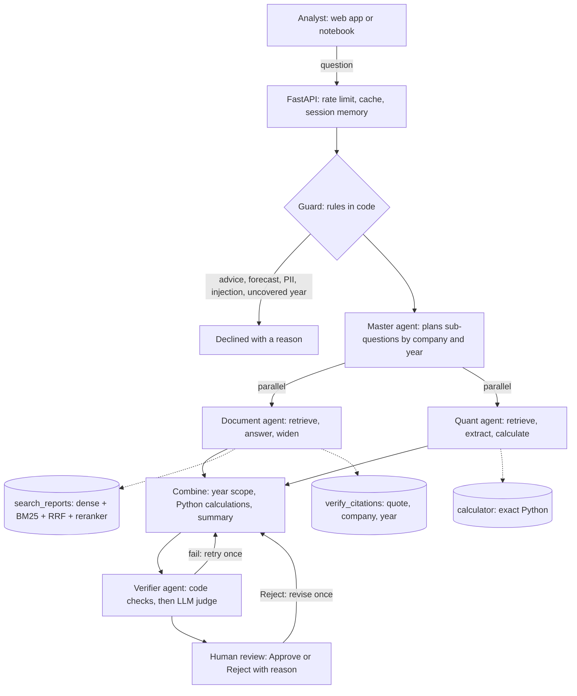

# InvestIQ Advisor

**An evidence-only, multi-agent research assistant for annual reports, built entirely on a hosted 8B model.**

InvestIQ Advisor answers an analyst's questions about **company annual reports (Form 10-K)**. It is built for any company's reports: drop the PDFs into `data/` and the agents pick up the new companies and fiscal years automatically. This release ships with, and was evaluated on, **Microsoft's and Apple's 10-Ks for fiscal years 2025–2026**. Every statement it makes cites the report file, the PDF page and a verbatim quote. A critic agent and a human analyst check each answer before it is used, and the system refuses investment advice, forecasts and requests for personal data.

Capstone project, **Track B (API-side)**, Executive PG Programme in Generative and Agentic AI, **IIT Kharagpur × upGrad**. Team **SPARTVIT-AI** (upGrad group 046-065), mentored by Dr. Kiran.

  -6E56CF)  

**Reports:** [Technical report (PDF, 12 pages)](docs/InvestIQ_Advisor_Technical_Report.pdf) · [Evaluation report (PDF)](docs/InvestIQ_Advisor_Evaluation_Report.pdf) · [Trace dashboard](results/trace_dashboard.html)

---

## Results at a glance

Final run on 24 November 2026: real Qwen3-8B, a frozen 60-question evaluation set, notebook v3.22.

| | Single-agent baseline | **InvestIQ agents** |
|---|---|---|
| Correct answers | 25 / 60 (42%) | **35 / 60 (58%)** |
| Accuracy (partial answer = 0.5) | 0.60 | **0.71** |
| Must-refuse questions refused | 7 / 8 | **8 / 8** |
| Red-team tests passed | — | **20 / 20** |
| Retrieval: gold page in top 8 | — | **90%** (recall@8 0.85) |
| Latency per question (mean / p95) | 43 s / 73 s | 42 s / 79 s |

| Question type | Baseline | Agents |
|---|---|---|
| Multi-hop across companies (7) | 0.57 | **0.93** |
| Calculations (9) | 0.50 | **0.72** |
| Multi-hop across years (14) | 0.43 | **0.57** |
| Must refuse (8) | 0.88 | **1.00** |
| Single facts and table figures (22) | **0.66** | 0.61 |

The agents gain most where a single prompt fails (comparisons across companies and calculations) and are slightly worse on single facts, mainly because their verifier rejects some correct answers. Details: [`results/`](results/), the [evaluation report](docs/InvestIQ_Advisor_Evaluation_Report.pdf) and the [technical report](docs/InvestIQ_Advisor_Technical_Report.pdf).

---

## What it does

Ask in plain English, for example:

- *"Compare how full-time headcount changed at Microsoft and at Apple from fiscal year 2025 to fiscal year 2026."*
- *"What share of Microsoft's full-time employees were based in the United States as of June 30, 2026?"*
- *"Which company spent more on research and development in fiscal year 2026, and by how much?"*

You get a short answer, the claims behind it (each with **file, PDF page and quote**), any calculation done in Python, the agent trail, and **Approve / Reject** buttons. A rejection needs a reason, and the agents revise the answer once using it.

It declines advice ("Should I buy Apple?"), forecasts ("revenue in 2028"), companies or years not in the reports, personal data, and instructions hidden in questions or documents.

---

## Add your own reports

1. Name each PDF `<TICKER>_10K_FY<year>.pdf` (for example `NVDA_10K_FY2026.pdf`) and put it in `data/`.
2. In notebook section 8, add the company's display name to `COMPANY_NAMES` (for example `"NVDA": "Nvidia"`), and its fiscal-year end to `FISCAL_YEAR_END` so the verifier can judge year-end dates.
3. Run all. The index is rebuilt for the new files, and the covered years (each report plus its two prior-year columns) are computed from the file names; questions about other years are declined.

The 60-question evaluation and all results in this repository cover the Microsoft and Apple reports only; accuracy on other companies' reports has not been measured.

## Architecture



Every node, tool call and model call emits an **OpenTelemetry** span.

| Layer | Implementation |
|---|---|
| Models | Qwen3-8B chat and bge-small-en-v1.5 embeddings, both behind OpenAI-compatible endpoints (no fine-tuning) |
| Retrieval | PyMuPDF text, ~120-word chunks; FAISS dense + BM25 fused with reciprocal rank fusion; `BAAI/bge-reranker-base` cross-encoder |
| Agents | LangGraph supervisor graph with document and quant sub-graphs, a verifier (critic), retries, a `MemorySaver` checkpointer and an analyst-review `interrupt` |
| Tools | `search_reports`, `calculator`, `verify_citations` (LangChain `@tool`) |
| Serving | FastAPI web app and API, rate limiting (HTTP 429), cache of verified answers, follow-up memory, Docker |
| Observability | OpenTelemetry spans, model-call log, per-run traces, self-contained trace dashboard |
| Evaluation | 60-question gold set, recall@k, 4 prompting strategies, failure taxonomy, RAGAS (official library + cross-check), 20-test red team |

---

## Repository layout

```
.
├── notebooks/InvestIQ_Advisor_v3_22.ipynb   the full system, evaluation and red team (single source of truth)
├── app/
│   ├── investiq_core.py                     the service, generated from the notebook
│   └── serve.py                             starts the FastAPI web app
├── scripts/export_app.py                    regenerates app/investiq_core.py from the notebook
├── data/                                    the four 10-K PDFs (public SEC filings)
├── eval/                                    60 questions with gold answers and gold pages
├── results/                                 every output of the final run, incl. trace_dashboard.html
├── docs/
│   ├── InvestIQ_Advisor_Technical_Report.pdf  12-page technical report
│   └── InvestIQ_Advisor_Evaluation_Report.pdf evaluation report with failure taxonomy
├── Dockerfile, docker-compose.yml, requirements.txt
└── README.md                                this file
```

---

## How to run it

> **Access note.** The system calls two OpenAI-compatible endpoints: a chat model (Qwen3-8B) and an embeddings model (bge-small-en-v1.5). In this project both are upGrad course endpoints whose keys and TLS certificates are **team-only** and are deliberately **not** in this repository. To run it yourself you need equivalent endpoints; to check our results without running anything, see [Validate the results](#validate-the-results-without-running-anything).

### Option A: Google Colab (evaluation and demo)

1. Put the project folder in Google Drive with this layout (the notebook finds it automatically):
   ```
   SPARTVIT-AI/
   ├── InvestIQ_Advisor_v3_22.ipynb
   ├── data/                              the four 10-K PDFs
   ├── chat-model/vm04-ca.crt             chat endpoint certificate
   └── VM02_Embeddings_Access/vm02-ca.crt embedding endpoint certificate
   ```
2. In Colab, open the notebook and add **Secrets** (🔑 in the left sidebar), with notebook access switched on:

   | Secret | Value |
   |---|---|
   | `qwen` | Chat API key (required) |
   | `EMBED_API_KEY` | Embeddings API key |
   | `RUN_BY` | Your first name; results go to `outputs/<name>/` |

3. **Runtime → Run all.** Section 2 prints a pre-flight checklist of the files it needs.
   - `QUICK_MODE = True` (section 2, default): 6 representative questions, about 10 minutes.
   - `QUICK_MODE = False`: all 60 questions, about 2 hours.
   - Every finished step is checkpointed to Drive; if Colab disconnects, **Run all** again and it continues where it stopped.
4. **Section 15** starts the web app inside Colab; add `/docs` to its address for the API page.


### Option B: Docker (web app and API)

```bash
mkdir -p project/data project/chat-model project/VM02_Embeddings_Access
cp data/*.pdf project/data/
# copy the two endpoint certificates into project/chat-model/ and project/VM02_Embeddings_Access/

cat > .env <<'EOF'
LLM_API_KEY=your-chat-key
EMBED_API_KEY=your-embedding-key
RUN_BY=service
# optional: LLM_BASE_URL=..., EMBED_BASE_URL=...
EOF

docker compose up --build
```

Open <http://localhost:8000> for the web app and <http://localhost:8000/docs> for the API. Keys come only from environment variables; certificates and reports are mounted at run time and never baked into the image.

### Option C: plain Python

```bash
python -m venv .venv && source .venv/bin/activate
pip install --index-url https://download.pytorch.org/whl/cpu torch
pip install -r requirements.txt
export INVESTIQ_PROJECT_DIR=/path/to/project   # folder holding data/, chat-model/, VM02_Embeddings_Access/
export LLM_API_KEY=... EMBED_API_KEY=...
cd app && python serve.py
```

If you change the notebook, regenerate the service with
`python scripts/export_app.py notebooks/InvestIQ_Advisor_v3_22.ipynb app/investiq_core.py`.

### API

| Endpoint | Purpose |
|---|---|
| `POST /chat` | `{"question": "...", "session_id": "..."}` → cited answer, status, agent trail, `answer_id` (waits for review) |
| `POST /review` | `{"answer_id": "...", "decision": "approved" \| "rejected", "comment": "..."}`; a reason is required to reject; returns the revised answer |
| `GET /health`, `GET /stats`, `GET /docs` | Status and coverage; usage counters (cache hits, rate-limited calls); Swagger UI |

---

## Validate the results (without running anything)

Everything the final run produced is in [`results/`](results/):

1. **Open `results/trace_dashboard.html`** in a browser (download it, then double-click). It shows the status mix, the failure taxonomy, where the time goes, and for each query a span waterfall, its agent trail and its citations.
2. **Recompute the headline numbers** from the raw files:
   ```python
   import pandas as pd
   a = pd.read_csv("results/eval_agents.csv")
   b = pd.read_csv("results/eval_summary.csv")
   score = {"correct": 1, "partial": 0.5, "wrong": 0}
   print("Agents:  ", (a.grade == "correct").sum(), "/ 60 correct, accuracy", round(a.grade.map(score).mean(), 3))
   print("Baseline:", (b.grade == "correct").sum(), "/ 60 correct, accuracy", round(b.grade.map(score).mean(), 3))
   r = pd.read_csv("results/retrieval_recall.csv")
   print(r.groupby("method")[["recall@1", "recall@8"]].mean().round(2))
   print(pd.read_csv("results/redteam_log.csv").result.value_counts())
   ```
   Expected: agents 35/60 (0.708), baseline 25/60 (0.6), reranked recall@8 0.85, red team 20 PASS.
3. **Check any answer against the source.** Each agent answer in `results/eval_agents_results.json` lists its claims with file, PDF page and quote; open the PDF in `data/` at that page.
4. **Check the gold answers.** `eval/ground_truth_questions_v4.csv` gives each question's expected answer and gold pages.

| File | What it holds |
|---|---|
| `retrieval_recall.csv` | recall@1/3/5/8 for dense, BM25, hybrid and reranked search |
| `eval_summary.csv` | single-agent baseline, 60 questions |
| `prompt_strategies_summary.csv` | zero-shot vs few-shot vs chain-of-thought vs decomposition |
| `eval_agents.csv`, `eval_metrics_agents.json` | agents, 60 questions, Track B metrics |
| `failure_taxonomy.csv` | retrieval miss / reasoning error / tool-call error / hallucination / verifier false fail |
| `direct_vs_decomposition.csv` | single search vs agent decomposition on multi-hop and calculation questions |
| `ragas_official.csv`, `ragas_own_prompts.csv` | RAGAS faithfulness, answer relevancy, context precision, context recall |
| `redteam_log.csv` | 20 adversarial tests and outcomes |
| `traces.jsonl`, `run_log.csv`, `otel_spans.jsonl` | per-run traces, per-call log, OpenTelemetry spans |

---

## Key findings

**Retrieval** (52 answerable questions)

| Method | recall@1 | recall@8 | gold page in top 8 |
|---|---|---|---|
| Dense only | 0.18 | 0.56 | 60% |
| BM25 only | 0.19 | 0.69 | 77% |
| Hybrid (RRF) | 0.25 | 0.80 | 87% |
| **Hybrid + reranker** | **0.40** | **0.85** | **90%** |

**Prompting strategies** (single agent, one answer call): few-shot is best (0.60), chain-of-thought worst (0.49: it made the 8B model abstain more often). There was no invalid JSON in 240 calls.

**RAGAS** (official library, 52 answers): faithfulness 0.73, answer relevancy 0.85, context precision 0.75, context recall 0.89.

**Failure taxonomy (agents):** none 29, reasoning error 22, verifier false fail 6, wrong answer passed the verifier 2, retrieval miss 1, tool-call error 0.

---

## Compensating for a small (8B) model

- **Code, not the model, checks:** every quote must appear in its passage; every number in a summary must appear in a cited claim; years outside the loaded reports are dropped.
- **Code, not the model, calculates:** the quant agent only selects figures; Python computes; swapped figures (part/whole, old/new) are fixed in code.
- **Schema validation and self-correction:** an invalid reply is sent back once with the reason it was rejected.
- **Decomposition:** one sub-question per company and year keeps each prompt small.
- **Hybrid retrieval and a reranker** catch the exact 10-K wording a small embedding model misses.
- **Rules before the model:** advice, forecasts, injection and personal-data requests are refused without a model call.
- **A human decides:** nothing is used until an analyst approves it.

---

## Responsible AI

| Area | What the system does | Evidence |
|---|---|---|
| Prompt injection in questions | Declined by a rule guard before any model call | RT01–RT05 pass |
| Injection hidden in documents | Retrieved passages that address an AI or give instructions are quarantined | RT06–RT09 pass (failed before the fix) |
| Personal data | Requests refused; emails, phone numbers and ID numbers typed in are masked in all logs | RT10–RT13 pass |
| Advice, forecasts, misuse | Declined | RT14–RT18 pass, 8/8 must-refuse questions |
| Human-in-the-loop | No external actions exist; every answer waits for Approve / Reject; a rejection needs a reason | RT19–RT20 pass |
| Secrets | Keys only in Colab Secrets or environment variables; never in code, logs, the image or this repository | — |

---

## Track B requirements: where each one is

| Requirement | Where |
|---|---|
| Task spec, refusal policy, 60–100 query eval set with gold answers | `eval/`, notebook §10 |
| Prompting baseline, ≥3 strategies, how the small model breaks | notebook §10b, `results/prompt_strategies*.csv` |
| RAG: chunking, hybrid BM25 + dense, reranker, citations, recall@k measured separately | notebook §6–7b, `results/retrieval_recall.csv` |
| Planner → executor → critic, ≥3 tools, persistent state, error handling | notebook §4 and §11 |
| Accuracy, task completion, tool calls, cost and latency, failure taxonomy, tracing | notebook §12–13c, `results/` |
| Front end, containerised, rate limiting, caching | notebook §15, `app/`, `Dockerfile` |
| Prompt-injection, PII, refusals, human-in-the-loop boundary | notebook §13b, `results/redteam_log.csv` |
| Evaluation report with failure taxonomy; 12-page technical report | `docs/InvestIQ_Advisor_Evaluation_Report.pdf`, `docs/InvestIQ_Advisor_Technical_Report.pdf` |

---

## Limitations and next steps

- **Tables are read as text**, so a figure's year column is sometimes misattributed. Next: table-aware extraction.
- **Verifier strictness:** 6 correct answers were rejected. Next: a completeness check, calibrated on a held-out set.
- **Automatic change calculation fires too often** when a question merely mentions growth (Q04, Q40). Next: calculate only when the question asks for a figure the reports do not state.
- **API concurrency:** the course endpoint limits concurrent requests per key (HTTP 429 at Q49; resumed from checkpoints). Next: retry a whole question with backoff.
- **Injection screening is pattern-based:** a planted false figure with no instruction would not be caught; the defence there is source integrity and analyst review.
- **Scale:** two companies and four reports; retrieval at 500–2,000 documents was not measured.
- **The Docker image** was tested as install-and-run steps outside Docker; build the image on a machine with access to container registries.

---

## Acknowledgements

IIT Kharagpur and upGrad for the programme and the hosted model endpoints; Dr. Kiran for mentoring. The 10-K reports are public filings with the U.S. Securities and Exchange Commission, included for reproducibility.

*InvestIQ Advisor supplies evidence from public filings. It is not investment advice.*
